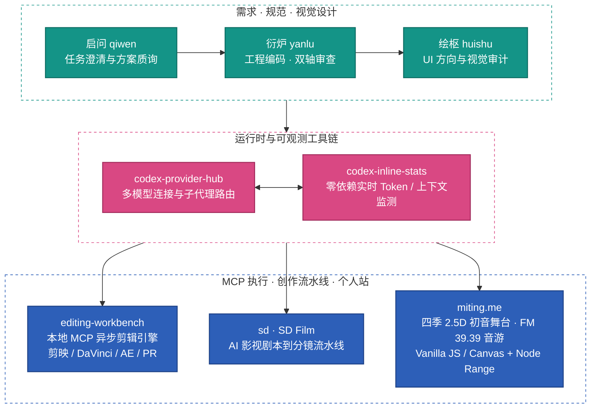

  <a href="https://miting.me/" title="访问一一的个人互动站 miting.me">
    <picture>
      <source media="(prefers-color-scheme: dark)" srcset="https://raw.githubusercontent.com/buyaoqifiyiyi/buyaoqifiyiyi/main/assets/fm39-banner-dark.svg?v=1">
      <source media="(prefers-color-scheme: light)" srcset="https://raw.githubusercontent.com/buyaoqifiyiyi/buyaoqifiyiyi/main/assets/fm39-banner-light.svg?v=1">
      
    </picture>
  </a>

> 📡 **FM 39.0 频道简介**：白天用 **原生 Web / Node.js** 与 **Python / MCP** 构建低依赖全栈工具和 AI Agent 工作流；余暇自研四季 **2.5D 初音看板娘舞台**、双模式音游，也偶尔剪一支同人影像。

---

## 📡 Agent 工具链与交互全景

---

## ✦ 精选代表作 · Full-Stack & AI Agent

<table>
  <tr>
    <td width="50%" valign="top">
      <h3>🎬 <a href="https://github.com/buyaoqifiyiyi/editing-workbench">editing-workbench</a></h3>
      
<strong>Agent 剪辑引擎</strong> · <code>Python</code> <code>MCP</code> <code>Agent</code>

      <ul>
        <li>面向剪映、DaVinci、AE、PR 的本地 MCP 异步编排（<code>describe_operations</code> / <code>start_job</code> / <code>job_status</code> / <code>read_job_output</code>）</li>
        <li>内置 <code>search_knowledge</code> 检索与草稿脚本执行管线，隔离长耗时任务与主对话上下文</li>
      </ul>
    </td>
    <td width="50%" valign="top">
      <h3>📊 <a href="https://github.com/buyaoqifiyiyi/codex-inline-stats">codex-inline-stats</a></h3>
      
<strong>Codex 实时用量监测</strong> · <code>Python</code> <code>Node.js</code> <code>Windows</code>

      <ul>
        <li>内嵌 DOM 统计栏 + 独立外置桌面窗口双模式，零第三方 npm / pip 依赖纯本地运行</li>
        <li>实时解析响应均速、累计 Token、缓存命中率与 70% 有效上下文交接预警</li>
      </ul>
    </td>
  </tr>
  <tr>
    <td width="50%" valign="top">
      <h3>🌸 <a href="https://miting.me/">miting.me</a></h3>
      
<strong>全栈交互个人站</strong> · <code>Vanilla JS</code> <code>Canvas 2.5D</code> <code>Web Audio</code> <code>Node.js</code>

      <ul>
        <li>零前端框架自研四季 2.5D Mesh Avatar 交互舞台、动作曲线库与实时频谱口型同步</li>
        <li>内置 <code>FM 39.39</code> 双模式音游（喵斯快跑 / 3D 星轨）及支持 HTTP <code>206 Range</code> 的媒体服务</li>
      </ul>
    </td>
    <td width="50%" valign="top">
      <h3>⚙ <a href="https://github.com/buyaoqifiyiyi/yanlu">yanlu</a> / <a href="https://github.com/buyaoqifiyiyi/huishu">huishu</a> / <a href="https://github.com/buyaoqifiyiyi/qiwen">qiwen</a></h3>
      
<strong>多宿主 Agent 技能生态</strong> · <code>Python</code> <code>Agent Skills</code> <code>Workflow</code>

      <ul>
        <li>串联需求质询（启问）、工程编码与双轴审查（衍炉）、UI 设计与视觉审计（绘枢）</li>
        <li>采用按需模块懒加载机制控制上下文预算，适配多 Agent 宿主工作规范</li>
      </ul>
    </td>
  </tr>
</table>

### 延伸工坊

- **[codex-provider-hub](https://github.com/buyaoqifiyiyi/codex-provider-hub)** — Codex 本地多模型连接、模型目录与子代理调度管理中心（支持 Responses / Chat Completions / Anthropic Messages / Gemini 原生接口）。
- **[sd](https://github.com/buyaoqifiyiyi/sd)** — AI 影视虚拟制片生产系统，串联剧本诊断、角色/场景设定、分镜规划与视频模型成片级 Prompt 输出。

---

## 🎛 频段参数 · 技术栈与同频坐标

| 维度 | 说明 |
| :--- | :--- |
| **全栈与前端交互** | `JavaScript (ES6+)` · `Node.js` (HTTP `Range` 流媒体服务) · `HTML5 Canvas` · `Web Audio API` · `CSS3` |
| **AI Agent 与工具链** | `Python` · `MCP (Model Context Protocol)` · 按需懒加载 Skill 架构 · 上下文可观测 · 自动化工作流 |
| **工程习惯** | 优先零依赖或轻量模块化、边界行为实测验证（HTTP 字节范围 / 真实浏览器检查）、本地隐私优先 |
| **同频坐标** | 个人站与在线 Demo：**[miting.me](https://miting.me/)** · 隐藏同频音游入口：`FM 39.39`（站内连按 `3` `9`） |

---

  <a href="https://miting.me/"><strong>miting.me</strong></a> · <a href="https://github.com/buyaoqifiyiyi"><strong>github.com/buyaoqifiyiyi</strong></a> 
  本主页及关联仓库中的同人影像与交互舞台演示均用于个人技术学习与作品展示。

